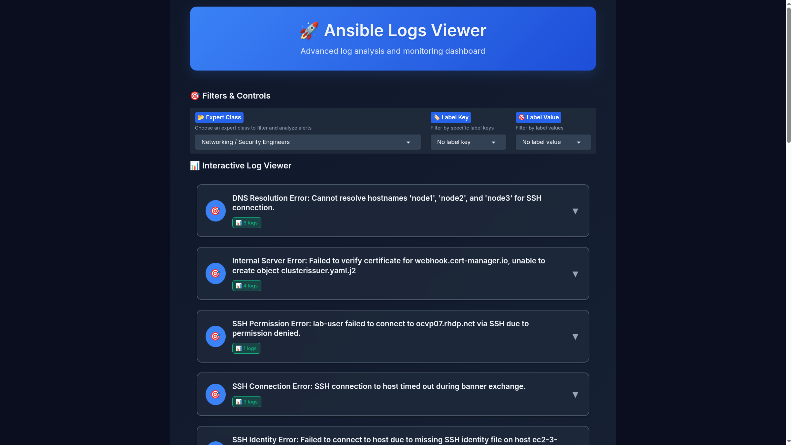
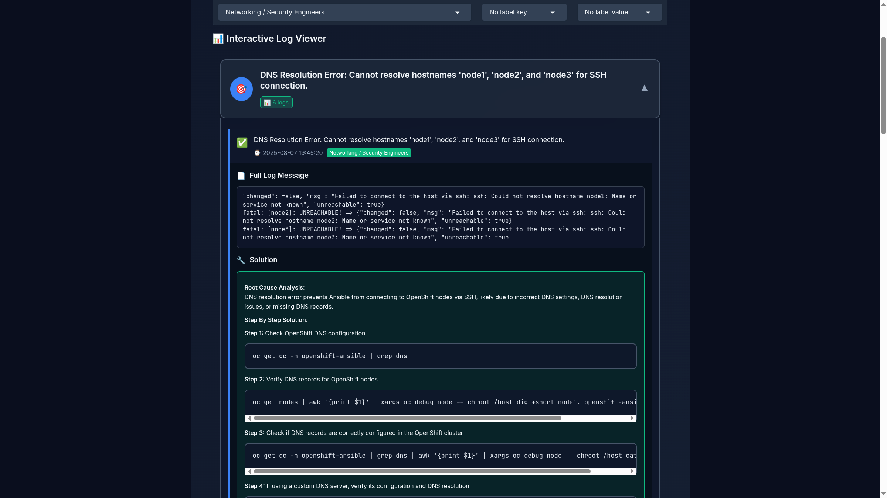
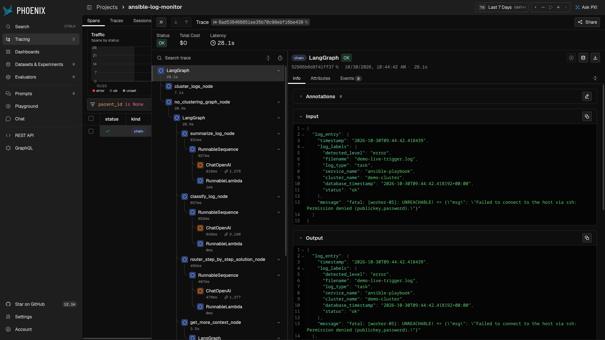

# Guide de démo — Ansible Log Monitor (AI Quickstart)

Quickstart officiel : https://docs.redhat.com/en/learn/ai-quickstarts/rh-ansible-log-analysis
Dépôt source : https://github.com/rh-ai-quickstart/ansible-log-analysis

Ce guide est pensé pour être suivi **pendant** la démo : pitch, URLs à ouvrir,
clics précis, et ce qu'il faut dire à chaque étape.

---

## 1. Le pitch en 30 secondes

> "Quand un job Ansible échoue sur une plateforme AAP à grande échelle, un
> humain doit : chercher le bon log, comprendre l'erreur, identifier qui a
> l'autorisation de la corriger (réseau ? AWS ? code ?), puis trouver la
> solution. Ça ne scale pas — plus de logs = plus d'effectifs.
>
> Cette solution automatise tout ça avec une IA agentique : elle regroupe les
> logs similaires, résume chaque type d'erreur, le route vers le bon profil
> d'expert, et génère une solution pas-à-pas en s'appuyant sur le code
> Ansible source et une base de connaissances (RAG)."

**Le visuel clé à garder en tête** : Logs AAP → Loki (stockage) → Agent IA
(LangGraph) → UI par rôle avec solution suggérée.

---

## 2. Check-list avant la démo

- [ ] `oc login` fait, namespace du déploiement identifié (ex. `ansible-logs-monitor`)
- [ ] Onglets ouverts et prêts (voir URLs en §3) :
  - [ ] UI principale (experts)
  - [ ] Grafana
  - [ ] Interface d'annotation / évaluation
  - [ ] Phoenix (traces LLM)
- [ ] Vérifier que des logs récents existent : dans l'UI, au moins quelques
      résumés d'alertes doivent apparaître (sinon relancer le replay — voir §6)
- [ ] Avoir en tête 2-3 logs d'exemple à cliquer en démo (prendre ceux qui ont
      déjà une solution générée, pour éviter d'attendre en live)

### Récupérer les URLs sur ta sandbox

```bash
oc get route -n <namespace>
```

| Route | Rôle dans la démo |
|---|---|
| `alm-ui` | **Écran principal** — UI experts (résumés, solutions) |
| `alm-annotation-interface` | Boucle d'amélioration humaine + évaluation |
| `grafana` | Dashboards logs bruts / alertes |
| `alm-phoenix` | Traces de l'agent LLM (observabilité) |
| `alm-aap-mock` | API du faux AAP (backstage, pas besoin de l'afficher) |

Identifiants Grafana : `admin` / `alm_password` (valeurs par défaut du chart).
Phoenix : **pas de login** — l'authentification est désactivée par
`sandbox-deploy/` (voir §7), l'URL mène directement au tableau de bord.

---

## 3. Déroulé de la démo (ordre recommandé)

### Étape A — Montrer le problème brut (Grafana) — 1 min

1. Ouvrir **Grafana**.
2. Aller dans **Explore** (icône boussole) → source de données **Loki**.
3. Requête : `{status=~"fatal|failed"}` → montrer le volume de logs d'erreur.
4. **Phrase clé** : *"Voilà le bruit qu'un analyste devrait trier
   manuellement. Des centaines de lignes, sans contexte ni priorité."*

### Étape B — L'UI experte : le cœur de la démo — 5 min

1. Ouvrir **alm-ui**.
2. **Sélectionner un rôle** dans la liste déroulante — c'est LE moment qui
   vend le produit :
   - *Kubernetes / OpenShift Cluster Admins* (le plus de clusters distincts — bon premier choix)
   - *Networking / Security Engineers*
   - *Cloud Infrastructure / AWS Engineers*
   - *DevOps / CI-CD Engineers (Ansible + Automation Platform)* (le plus de volume)
   - *Application Developers / GitOps / Platform Engineers*
   - *Identity & Access Management (IAM) Engineers*
   - *System Administrators / OS Engineers*
   - *Other / Miscellaneous*

   **Phrase clé** : *"Chaque profil ne voit QUE les erreurs qui le
   concernent — plus besoin de faire le tri entre une erreur réseau et un
   bug applicatif."*

   > 💡 Astuce : au premier chargement après sélection, laisse 1-2 secondes
   > — le premier appel API peut sembler vide avant que la liste se
   > remplisse (race condition d'affichage côté Gradio, pas un manque de
   > données : les 8 rôles ont tous des logs classifiés sur ce déploiement).

3. Montrer la liste des **résumés de templates de logs** (un résumé = un
   groupe de logs similaires, pas un log brut un par un) :

   

4. Utiliser les **filtres par label** (cluster, fichier de log…) pour montrer
   qu'on peut cibler un périmètre précis.
5. **Cliquer sur un résumé**, puis sur une occurrence individuelle → montrer :
   - le **log brut complet**
   - l'**analyse de cause racine** générée par l'IA
   - la **solution pas-à-pas**, avec des commandes `oc`/Ansible concrètes
   - les labels / timestamp

   

   **Phrase clé** : *"L'agent a déterminé seul s'il avait besoin de plus de
   contexte — en interrogeant Loki pour les logs voisins, ou le code Ansible
   source via MCP — avant de proposer cette solution, jusqu'aux commandes
   exactes à lancer."*

### Étape C — La boucle d'amélioration humaine — 3 min

1. Ouvrir l'**interface d'annotation**.
2. Montrer qu'un expert peut annoter un log avec la "vraie" solution
   (golden answer).
3. Expliquer l'évaluation **LLM-as-a-judge** : on compare la sortie de
   l'agent à l'annotation humaine pour détecter où le prompt / les données /
   le code doivent être améliorés.
   **Phrase clé** : *"Ce n'est pas une boîte noire figée : le système
   s'améliore avec les retours des experts, sans réentraîner un modèle
   complet."*

### Étape D — Sous le capot : l'observabilité de l'agent — 2 min

1. Ouvrir **Phoenix** (pas de login — auth désactivée, voir §7).
2. Aller dans le projet **ansible-log-monitor** (pas `default`, qui reste
   vide) → onglet **Spans**.
3. Cliquer sur une trace **LangGraph** récente → montrer l'arbre complet :
   `cluster_logs_node` → `summarize_log_node` → `classify_log_node` →
   `router_step_by_step_solution_node` → `get_more_context_node`, chaque
   nœud avec son appel `ChatOpenAI`, ses tokens, sa latence.

   

   **Phrase clé** : *"Chaque décision de l'agent est traçable — utile pour
   le debug, et pour prouver la valeur à un responsable sécurité ou FinOps."*

   > 💡 **Astuce "effet wow" en direct** : pour générer une trace fraîche
   > pendant la démo (plutôt que de montrer une trace déjà ancienne), lance
   > ce one-liner depuis un terminal avec `oc` connecté — il injecte un faux
   > log d'erreur directement dans le pipeline agent et affiche la solution
   > générée en ~20-30s. Rafraîchis Phoenix juste après pour voir la
   > nouvelle trace apparaître en direct :
   >
   > ```bash
   > oc exec -n ansible-logs-monitor deploy/alm-backend -- curl -s -X POST \
   >   "http://localhost:8000/grafana-alert/?log_message=fatal:%20%5Bworker-05%5D:%20UNREACHABLE!%20%3D%3E%20%7B%22msg%22%3A%20%22Failed%20to%20connect%20to%20the%20host%20via%20ssh%3A%20Permission%20denied%20(publickey%2Cpassword).%22%7D&detected_level=error&filename=demo-live-trigger.log&service_name=ansible-playbook&cluster_name=demo-cluster&log_type=task"
   > ```

### Étape E — Clôture — 1 min

Reprendre le pitch de l'étape 1 et enchaîner sur les questions.

---

## 4. Questions fréquentes (et réponses courtes)

| Question | Réponse |
|---|---|
| **Quel LLM est utilisé ?** | N'importe quel endpoint compatible OpenAI — ici un modèle **Llama 3.2 3B Instruct** servi via **OpenShift AI / vLLM**, avec tool-calling natif. |
| **Comment fonctionne le routage par autorisation ?** | Chaque template de log est classifié par domaine (réseau, AWS, code, IAM...) ; l'UI filtre par rôle sélectionné. |
| **Ça scale comment ?** | Le clustering groupe les logs similaires — l'effort humain n'augmente pas linéairement avec le volume de logs. |
| **Et les données sensibles ?** | Tout tourne dans le cluster du client (Loki, LLM, vecteurs) — rien n'est envoyé à un tiers si on utilise un LLM auto-hébergé (comme ici). |
| **Combien de temps pour déployer ?** | Avec l'automatisation du dossier `sandbox-deploy/` : quelques minutes pour l'infra, puis ~20-30 min d'indexation initiale (one-shot, dépend du CPU/GPU disponible pour l'embedding). |
| **C'est reproductible sur un autre environnement ?** | Oui — voir `sandbox-deploy/README.md` : playbook Ansible idempotent, auto-détection du LLM disponible sur le cluster cible. |

---

## 5. Ce qui tourne réellement (pour toi, pas pour l'audience)

- **Loki** : stockage des logs (mode single-binary, 1 réplica sur ce sandbox mono-nœud)
- **Alloy** : collecte des logs depuis `aap-mock` (générateur de logs AAP simulés)
- **Backend (FastAPI + LangGraph)** : pipeline agentique (clustering → classification → génération de solution)
- **RAG (FAISS + MinIO + TEI)** : base de connaissances (PDF d'erreurs connues)
- **PostgreSQL (pgvector)** : alertes traitées + métadonnées
- **Phoenix** : traces OpenTelemetry de l'agent
- **UI / Annotation Interface** : Gradio

## 6. Dépannage rapide pendant la démo

**"Je ne vois aucune alerte dans l'UI"** → le replay des logs mock s'est
peut-être arrêté. Depuis la sandbox :

```bash
ROUTE=$(oc get route alm-aap-mock -n <namespace> -o jsonpath='{.spec.host}')
curl -X POST "http://$ROUTE/api/logs/replay" \
  -H "Content-Type: application/json" \
  -d '{"source":"auto-loaded","id_or_path":"all","loop":true,"rate_lines_per_sec":80}'
```

**"Un pod n'est pas prêt"** → `oc get pods -n <namespace>`, voir aussi les
limitations connues en §7.

---

## 7. Limitations connues sur un sandbox mono-nœud (déjà corrigées par `sandbox-deploy/`)

- Les images communautaires MinIO ont été retirées de Docker Hub/Quay en
  octobre 2025 → remplacées par les rebuilds `pgsty/minio` et `pgsty/mc`.
- Loki par défaut veut 3 réplicas / `replication_factor: 3` → impossible sur
  1 seul nœud → forcé à 1.
- **Phoenix** (`arizephoenix/phoenix:latest`, tag flottant) a activé
  l'**authentification par défaut** dans une version récente (v21) sans
  qu'aucun `PHOENIX_SECRET` ne soit configuré par le chart → le backend se
  faisait rejeter en `401 Unauthorized` à chaque envoi de trace OTLP, et
  l'étape "observabilité" de la démo tombait à plat (Phoenix vide). Corrigé
  en forçant `PHOENIX_ENABLE_AUTH: "False"` (déploiement mono-utilisateur de
  démo, pas besoin d'auth multi-tenant). Conséquence pratique : **l'URL
  Phoenix s'ouvre directement sur le tableau de bord, sans écran de login**
  — vérifié à la fois sur une requête GraphQL sans aucun header d'auth et
  dans le navigateur. Sur une nouvelle sandbox, ce sera le comportement dès
  le premier déploiement (le fix est dans `single-node-overrides.yaml`,
  appliqué automatiquement).
- L'indexation RAG initiale (643 chunks) tourne sur CPU (pas de GPU libre
  pour le service d'embedding sur ce sandbox) → compter ~20-30 min la
  première fois seulement. Les déploiements suivants (upgrade) ne refont pas
  ce travail si les données ne changent pas.

Voir `sandbox-deploy/files/single-node-overrides.yaml` pour le détail technique.
